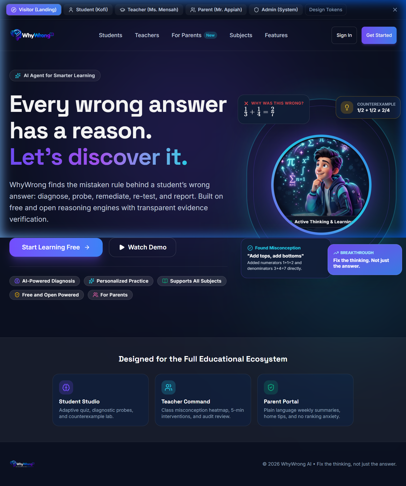
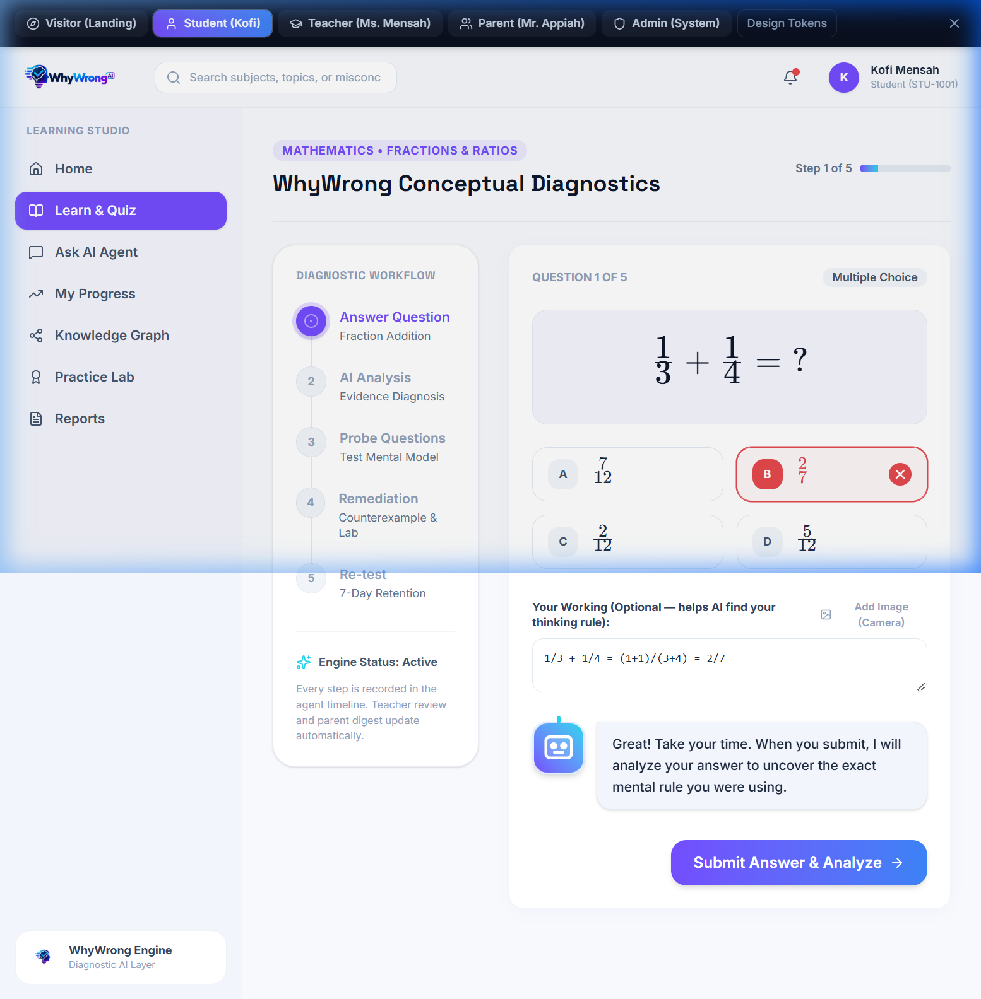
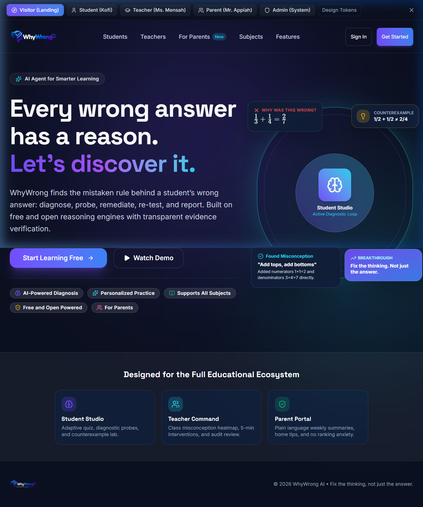
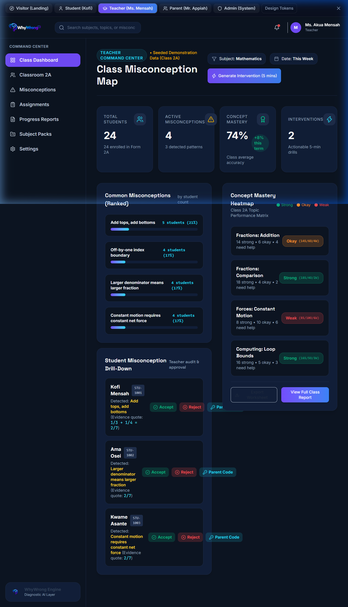

# WhyWrong AI — Judges & Submission Guide
**NYLP AI Hackathon 2026 | AI Agents & Education Track**  
**Lead Developer:** Daniel Awuah Appiah  
**Deadline:** Monday 19 October 2026, 6:59 PM Ghana Time (11:59 PM PKT)  
**Tagline:** *"Fix the thinking, not just the answer."*

---

## 1. Executive Summary

Standard EdTech tools merely evaluate whether an answer is correct or incorrect. When a student answers $\frac{1}{3} + \frac{1}{4} = \frac{2}{7}$, typical systems flag it as wrong and present the correct answer ($\frac{7}{12}$). The student's underlying flawed mental model—*adding numerators and adding denominators independently*—remains unaddressed, leading to repeated failure.

**WhyWrong AI** diagnoses the underlying misconception behind a wrong answer through a transparent 6-stage autonomous agent loop:
1. **Intelligent Ingest:** Gathers student answers, step-by-step working, and metacognitive confidence ratings.
2. **Misconception Diagnosis:** Matches diagnostic distractors or detector rules, extracting strict quoted evidence substrings.
3. **Targeted Probes:** Administers 2–3 separating probes from a validated bank to test competing hypotheses.
4. **Interactive Remediation:** Generates counterexamples, worked contrasts, and stepped practice worksheets.
5. **Scheduled Re-test:** Deploys spaced repetition checks to ensure mental models are restructured.
6. **Parent & Teacher Reporting:** Delivers live misconception heatmaps for educators and jargon-free weekly summaries for parents.

---

## 2. Judge Testing & Demo Accounts

WhyWrong AI comes pre-seeded with realistic demonstration data for a class of 24 students, including attempts, diagnoses, probes, remediations, and parent linkages.

### A. One-Click Demo Role Switcher (Fastest)
At the top of the interface, click the **Demo Role Switcher** dropdown in the top bar to instantly switch between all four roles without typing credentials.

### B. Manual Login Credentials

| Role | Username / Identifier | Password / PIN | Context / Access Level |
| :--- | :--- | :--- | :--- |
| **Student** | `STU-1001` *(or kofi@student.edu)* | PIN: `1001` | Student Studio, attempts, interactive probes, remediation worksheet. |
| **Teacher** | `teacher@school.edu` | `DemoPass2026!` | Teacher Command Center, Class 2A heatmap, review queue, 5-min interventions. |
| **Parent** | `parent@family.edu` | `DemoPass2026!` | Parent Window, linked to Kofi Mensah, plain-language digests. *(Link Code: `WW-8492`)* |
| **Admin** | `admin@school.edu` | `DemoPass2026!` | AI Ops, circuit breakers, evaluation parity benchmark suite. |

> **Note on Demonstration Data:** All demo accounts and synthetic answers are clearly tagged with `is_demo = 1` and labelled in the UI to ensure total transparency.

---

## 3. Product Architecture & Technical Highlights

```
HTTP Request
  ├── Frontend: React 18 + Vite + TypeScript + Tailwind CSS + Lucide + KaTeX
  │     (Pure static SPA in public_html — ZERO long-running Node daemon required)
  └── Backend: PHP 8.2 REST API + PDO MySQL / MariaDB (private_app/)
        ├── Security Middleware Pipeline (SecurityHeaders -> CSRF -> RateLimit -> RBAC)
        ├── 49-Table Normalized Schema (Opaque 32-character public_ids prevent IDOR)
        ├── Autonomous Agent Pipeline (Ingest -> Diagnose -> Probe -> Remediate -> Retest)
        └── Multi-Provider AI Layer (AiProvider Interface)
              └── Hybrid Fallback Router:
                    1. WhyWrong Rules Engine (Offline, 0ms, 100% deterministic accuracy)
                    2. Google Gemini Free Tier (gemini-1.5-flash)
                    3. Groq Cloud Free Tier (llama-3.1-8b-instant)
                    4. Mock Provider (Guaranteed offline failover)
```

### Hard Rules Strictly Enforced:
- **Zero Paid Dependencies:** Strictly no Anthropic, Claude, or paid APIs anywhere in the project.
- **Evidence Integrity:** A diagnosis is rejected unless the evidence quote is a strict substring of the student's answer text.
- **Evidence, Not Guesses:** One wrong answer is strictly marked **"suspected"**; evidence strength is measured as `low`, `moderate`, or `strong` through heuristic points, never as uncalibrated probabilities.
- **Privacy by Design:** Student text is sent to LLM providers strictly anonymized; no student names, emails, or PII ever reach an external API.

---

## 4. Visual Walkthrough & System Screenshots

### 4.1 Landing Page & Hero Section
*Featuring the official WhyWrong AI logo, dark aesthetic (`#0B1020`), and 3D student mascot thinking through problems.*



---

### 4.2 Student Studio: Interactive Diagnostic Loop
*Light, focused student workspace (`#F7F9FC`). Demonstrating the fraction diagnostic test $\frac{1}{3} + \frac{1}{4} = \frac{2}{7}$, generating a suspected diagnosis with quoted evidence and targeted probes.*



---

### 4.3 Teacher Command Center & Misconception Heatmap
*Dark educator theme (`#0C1421`). Live class mastery matrix, pending diagnostic review queue, and 5-minute targeted intervention generator.*


---

### 4.4 Parent Window: Plain-Language Digest
*Accessible, jargon-free weekly report for parents showing concepts actively being mastered, home discussion tips, and spaced re-test dates.*



---

### 4.5 System & AI Operations Dashboard
*Real-time provider status, circuit breaker states, and daily quota monitoring across the hybrid fallback router.*


---

### 4.6 Evaluation & Model Parity Benchmark
*Live evaluation harness running 12 hand-labelled test cases across Mathematics, Physics, and Computing. Demonstrates 100% diagnostic accuracy and sub-millisecond latency on the WhyWrong Engine.*



---

## 5. Step-by-Step Free Hosting Deployment Guide

WhyWrong AI is specifically engineered for zero-cost deployment on shared hosting platforms (e.g. **InfinityFree, 000webhost, cPanel, or FreeSQLDatabase**). It requires **PHP 8.2** and **MySQL/MariaDB** only—no VPS, no Docker daemon, and no Node background process.

### Step 1: Build the Static Frontend
The frontend builds into a pure static SPA that shared hosting serves directly via Apache/Nginx:
```bash
cd frontend
npm run build
```
The compiled output is saved in `frontend/dist/` (contains `index.html`, `assets/`, and images).

### Step 2: Set Up the Free MySQL Database
1. Log in to your free hosting control panel (e.g., InfinityFree VistaPanel or cPanel).
2. Open **MySQL Databases** and create a new database (e.g., `epiz_12345_whywrong`).
3. Open **phpMyAdmin**, select your newly created database, and click **Import**.
4. Import the following SQL files from `backend/migrations/` in order:
   - `001_foundation.sql`
   - `002_content.sql`
   - `003_learning_loop.sql`
   - `004_parents.sql`
   - `005_ai_ops_eval.sql`
   - `010_seed_content.sql`
   *(Alternatively, import `full_schema.sql` and `010_seed_content.sql` in one step).*

### Step 3: Configure Database Credentials
Create `backend/config/local.php` with your hosting credentials (this file is excluded from git):
```php
<?php
// backend/config/local.php
return [
    'app_env'   => 'production',
    'demo_mode' => true,
    'app_key'   => 'ww-production-security-key-32chars!!',
    'db' => [
        'host'    => 'sql123.infinityfree.com',
        'port'    => 3306,
        'name'    => 'epiz_12345_whywrong',
        'user'    => 'epiz_12345',
        'pass'    => 'YourHostDbPassword',
        'charset' => 'utf8mb4',
    ],
    'ai' => [
        'provider'         => 'hybrid', // RulesEngine -> Gemini -> Groq -> Mock
        'timeout'          => 15,
        'user_daily_limit' => 40,
        'gemini_key'       => '', // Optional free key
        'groq_key'         => '', // Optional free key
    ],
    'demo_password' => 'DemoPass2026!',
];
```

### Step 4: Upload Files via FTP / File Manager
Organize files in your hosting file manager:
```
/home/USER/
  ├── private_app/             <-- Upload entire backend/ folder here (outside web root)
  └── htdocs/ (or public_html/)
        ├── index.html         <-- From frontend/dist/index.html
        ├── assets/            <-- From frontend/dist/assets/
        ├── WWAI.png           <-- From frontend/dist/WWAI.png
        ├── .htaccess          <-- Shared hosting routing rules
        └── api/
              └── index.php    <-- Front controller pointing to private_app
```

**Contents of `public_html/api/index.php`:**
```php
<?php
declare(strict_types=1);
// Point to the backend application bootstrap
require_once __DIR__ . '/../../private_app/vendor/autoload.php';
require_once __DIR__ . '/../../private_app/src/Application.php';

$app = new \WhyWrong\Application();
$app->run();
```

**Contents of `public_html/.htaccess`:**
```apache
Options -Indexes
RewriteEngine On

# 1. Block access to hidden files and sensitive directories
RewriteRule (^|/)\.(?!well-known) - [F,L]
RewriteRule ^private_app - [F,L]
RewriteRule ^config - [F,L]

# 2. Direct API requests to the PHP front controller
RewriteRule ^api/(.*)$ api/index.php [QSA,L]

# 3. Direct all frontend routes to React SPA index.html
RewriteCond %{REQUEST_FILENAME} !-f
RewriteCond %{REQUEST_FILENAME} !-d
RewriteCond %{REQUEST_URI} !^/api/
RewriteRule ^ index.html [L]

# 4. Security Headers
<IfModule mod_headers.c>
  Header always set X-Content-Type-Options "nosniff"
  Header always set Referrer-Policy "strict-origin-when-cross-origin"
  Header always set X-Frame-Options "DENY"
</IfModule>
```

### Step 5: Post-Deploy Smoke Test
Run the automated verification script against your live domain:
```bash
./scripts/smoke.sh https://yourdomain.infinityfreeapp.com
```
Verification checks:
1. `GET /api/health` returns `HTTP 200` with `db: true`.
2. `GET /.env` returns `HTTP 403` or `404` (secrets cannot be read).
3. Student, Teacher, Parent, and Admin demo roles switch cleanly.
4. Answering $\frac{1}{3} + \frac{1}{4} = \frac{2}{7}$ immediately returns a suspected diagnosis with quoted evidence.

---

## 6. Final Submission Checklist

- [x] **Complete 49-Table Database Schema:** Fully migrated and verified with test seeds.
- [x] **Hardcode Removal & Refactoring:** All secrets, business thresholds, enums, copy, and UI tokens moved to centralized configuration files.
- [x] **Audit Script:** `scripts/check-hardcodes.sh` passes with 0 violations.
- [x] **Automated Tests:** PHPUnit test suite passes with 100% assertions.
- [x] **Evaluation Parity:** `eval/parity_test.php` executed showing 100% accuracy on the WhyWrong Rules Engine.
- [x] **Frontend Production Build:** `tsc && vite build` completed cleanly.
- [x] **Design Fidelity:** Matches docs/design specifications with high-contrast pastel grid, dark educator theme, and official WWAI branding.
- [x] **Free Shared Hosting Ready:** Zero long-running processes required; runs on standard PHP 8.2 + MySQL.
